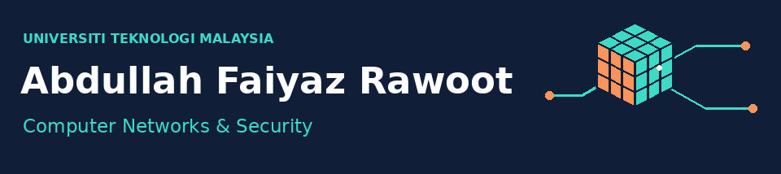
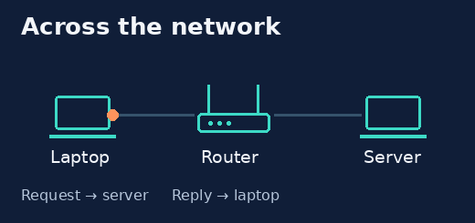
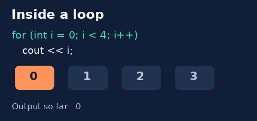
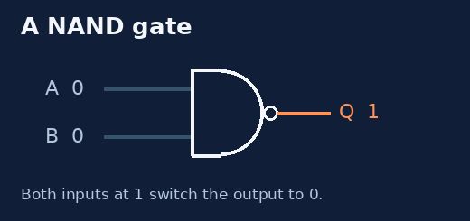
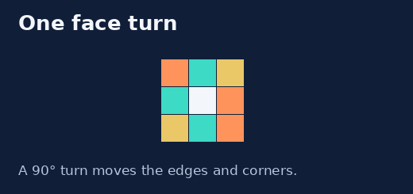

## Hey, I’m Abdullah

I’m a first-year CS student at UTM. I grew up in Kuwait with two parents who work in computer science and an uncle who works in cybersecurity. Computers have interested me for as long as I can remember. And yes, the movies made cybersecurity look pretty cool too.

I like physics, maths, and CS for the same reason. Give me something to figure out and I’ll happily spend time on it. Once I understand why it works, I can usually work it out again.

## What I’m curious about

How does a website’s reply find its way back to the laptop that asked for it? That’s one of the questions that got me interested in networks. Here’s a simplified picture of a request travelling out and a reply coming back.

## On my desk this semester

| Programming Technique I | Digital Logic |
| --- | --- |
|  |  |
| I’m learning C++. I like predicting what a loop will print before I run it. In this one, the interesting bit is why it stops before printing 4. | I’m learning to draw circuits from Boolean expressions. Watch what happens to the output when both inputs reach 1. |

## My first GitHub project

[**Professional Development Portfolio ↗**](https://github.com/Aboudi1508/professional-development-portfolio)  
I built this during our TIS workshop. Writing the README, saving my first commit, and sharing the link were my introduction to GitHub.

## Away from the keyboard

I can solve a Rubik’s Cube in under a minute, and I solve the 4×4 too. When I play chess, my go-to is 10+5.

[GitHub activity ↗](https://github.com/Aboudi1508?tab=overview)
